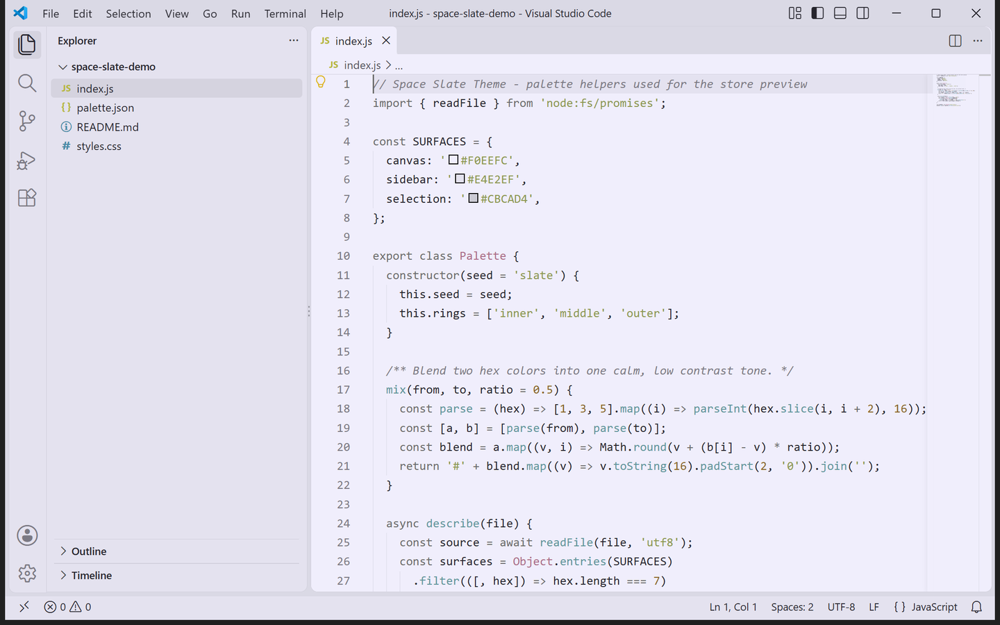
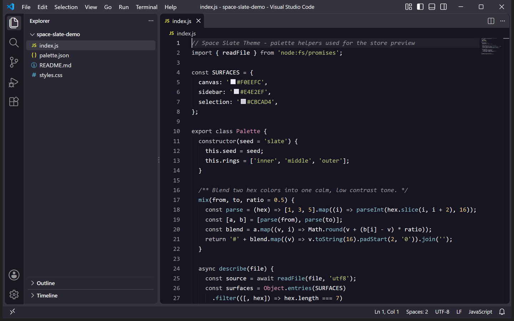

<p align="center">
  
</p>

<h1 align="center">Space Slate Theme</h1>

<p align="center">
  A calm slate gray theme for Visual Studio Code, with a lavender tinted light variant and a deep indigo dark variant.
</p>

<p align="center">
  <a href="https://marketplace.visualstudio.com/items?itemName=lilinhuang.space-slate-theme">
    
  </a>
  <a href="https://github.com/vaxicy/space-slate-theme/blob/master/LICENSE">
    
  </a>
</p>

## Previews

<p align="center">
  
  
</p>

Left is the light variant, right is the dark variant. Both were captured from a
real Visual Studio Code window with the extension installed, on the same
JavaScript file and the same layout.

## Introduction

Space Slate Theme is a quiet, low saturation color theme for Visual Studio
Code. It is built around the idea of a dark, dusty slate surface floating in a
muted space: neutral slate accents, a lavender tinted light canvas, and a deep
indigo dark canvas, so neither variant fights for attention with your code.

The extension ships two selectable variants from one visual family:

- **Space Slate Theme Light** — a lavender canvas (`#F0EEFC`) with near black text and slate accents.
- **Space Slate Theme Dark** — a deep indigo canvas (`#171522`) with off white text and light slate accents.

## Palette

| Role | Light | Dark | Name |
| --- | --- | --- | --- |
| Editor canvas | `#F0EEFC` | `#171522` | slate base |
| Side bar | `#E4E2EF` | `#292733` | slate layer |
| Title bar | `#DAD9E5` | `#35333E` | slate edge |
| Selection | `#CBCAD4` | `#47454F` | muted slate |
| Accent | `#6C6C6C` | `#C2C2C2` | slate accent |
| Foreground | `#26252D` | `#F6F6F6` | ink / off white |

## Syntax

Comments stay quiet and italic (`#7B7984` / `#949396`), keywords and tags keep
the calm slate accent, strings use a muted sage (`#8C974E` / `#B3BF7A`), numbers
a warm amber (`#896525` / `#DFC088`), types and classes a dusty rose (`#AC6C88` /
`#D393AF`), and functions a soft teal (`#60959B` / `#87BBC2`). Semantic
highlighting is enabled, so TypeScript, JavaScript and Python pick up accurate
class, interface, enum, function, method, parameter, property and variable
colors on top of the TextMate rules.

Every accent is intentionally desaturated: the theme stays readable for long
sessions without the usual neon syntax rainbow.

## Installation

1. Open the Extensions view (`Ctrl+Shift+X` / `Cmd+Shift+X`).
2. Search for `Space Slate Theme`.
3. Click **Install**.

Or install from the command line:

```
code --install-extension lilinhuang.space-slate-theme
```

## Usage

1. Open the Command Palette (`Ctrl+Shift+P` / `Cmd+Shift+P`).
2. Run **Preferences: Color Theme** (or `Ctrl+K Ctrl+T`).
3. Pick **Space Slate Theme Light** or **Space Slate Theme Dark**.

## Notes

- Both variants theme the whole workbench, not only the editor: activity bar,
  side bar, tabs, panels, terminal, command list, quick input, widgets, badges,
  inputs, notifications, diffs and Git decorations.
- A matching 16 color ANSI palette keeps the integrated terminal in the same
  slate family.
- The README previews are real VS Code window captures taken with the extension
  installed, so what you see is what the theme renders.

## Development

Open this folder in VS Code and press **F5** to launch an Extension Development
Host with the theme applied.

To regenerate the README previews, with VS Code installed:

```
python3 scripts/capture-real-screenshots.py
```

The script builds a throwaway VS Code profile, installs this theme into it,
opens the sample project under `scripts/demo-project` and captures the window
for both variants into `store-assets/screenshots/en/`.

## Feedback

Suggestions and issues are welcome — please open an issue or pull request on
the project repository.

## License

MIT — see [LICENSE](https://github.com/vaxicy/space-slate-theme/blob/master/LICENSE).
